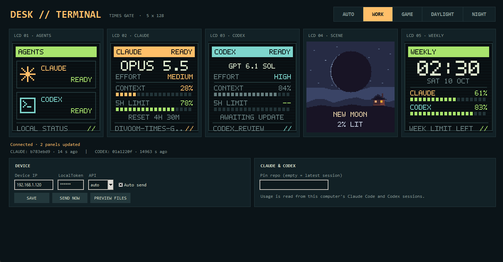
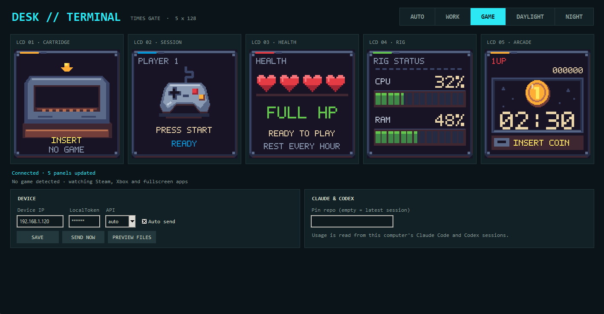
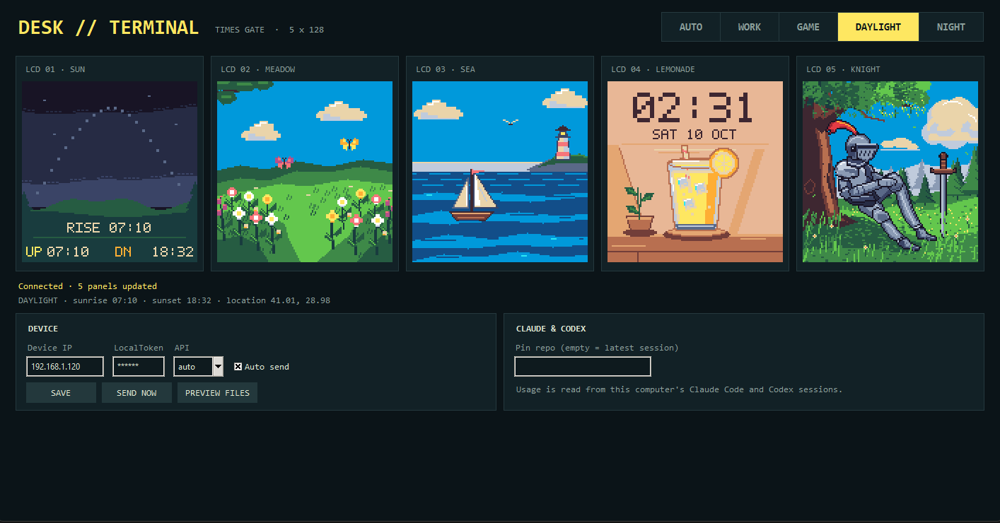
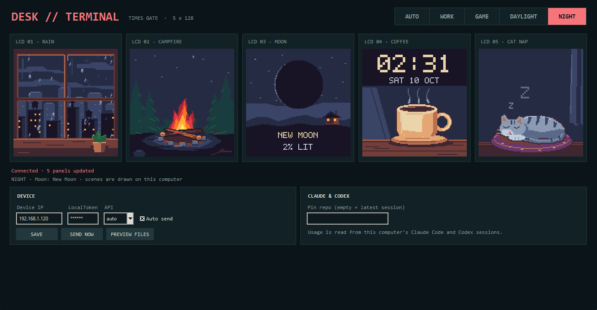

# Times Gate Desk Terminal

Turn a [Divoom Times Gate](https://divoom.com) into a desk companion for Windows: your Claude Code and Codex
usage while you work, the game you are playing in the evening, and hand-drawn pixel scenes in between.



**[⬇ Download for Windows](https://github.com/gokselozr/divoom-times-gate/releases/latest/download/TimesGateAI-Windows-x64.zip)**
· Windows 10/11 64-bit · no Python needed

---

## What you get

The app shows the five panels it sends to your Times Gate, and switches between four modes,
by hand or automatically.

### WORK
Claude Code and Codex at a glance: which agent is busy, model and effort, how much context is left,
5-hour and weekly limits with their reset times. The fourth screen shows a scene that follows the sun.
*(screenshot above)*

### GAME


Starts when you play. Steam and Xbox / Game Pass games show their real cover art and icon, Steam
games also your total hours played as a level. You get a session timer, hearts that drain over an
hour and then remind you to take a break, live CPU / RAM, and an arcade clock.

### DAYLIGHT


Today's real sun path with sunrise and sunset, a windy meadow, the sea, lemonade with the clock, and a
knight resting under a tree.

### NIGHT


Rain on the window, a campfire, today's real moon phase, coffee with the clock, and a sleeping cat.

### AUTO
Picks the mode from the clock and switches to GAME when you start playing after hours:

| | 07:00–09:00 | 09:00–18:00 | 18:00–19:00 | 19:00–07:00 |
|---|---|---|---|---|
| **Weekdays** | DAYLIGHT | WORK | NIGHT | NIGHT |
| **Weekends** | DAYLIGHT | DAYLIGHT | DAYLIGHT | NIGHT |

A running game takes over on weekday evenings and nights and all weekend, and the clock takes over
again when the game closes. During weekday work hours games are not even looked for.

---

## Getting started

**You need:** a Divoom Times Gate on the same network as your PC, its IP address, and its LocalToken.
You can find both in the Divoom app under the device's settings; the IP is also listed in your
router's device list.

1. **[Download the latest release](https://github.com/gokselozr/divoom-times-gate/releases/latest)**
   (`TimesGateAI-Windows-x64.zip`) and extract the **whole** ZIP to a permanent folder, for example
   `C:\Tools\TimesGate`. Do not run it from inside the ZIP.
2. Open **TimesGate.exe**. If Windows SmartScreen warns about an unknown publisher, choose
   *More info → Run anyway* (the app is not code-signed).
3. When Windows Firewall asks, **allow it on private networks**. The Times Gate downloads every panel
   from the app; without this the screens do not change.
4. Enter the **Device IP** and **LocalToken**, press **SAVE**, then **SEND NOW**. The five screens
   should update within a few seconds.
5. Tick **Auto send** to keep them updating, and pick a mode at the top right (try **AUTO**).

Keep the app running while you use the display. If it is closed and the Times Gate restarts, the screens
can stay on "loading" until the app is back.

### Claude Code and Codex
Usage comes from the Claude Code and Codex sessions **on the same PC**, so nothing to sign in to.
Codex is read from its session files. Claude Code only hands these numbers to its status line, so the
app adds a small bridge to Claude Code's settings each time it starts; if you already have a custom
status line, it keeps working. Numbers appear after your next Claude reply.

To pin the WORK screens to one project instead of the latest session, type its folder name into
**Pin repo**.

### Location
The sun panel and the WORK scene use Istanbul's sunrise and sunset by default. Elsewhere, close the app
and set `"latitude"` and `"longitude"` in `%LOCALAPPDATA%\TimesGateAI\config.local.json`.

### Updating
Download the new release and extract it over the old folder. Your settings live in
`%LOCALAPPDATA%\TimesGateAI` and are kept.

---

## Troubleshooting

| Symptom | What to check |
|---|---|
| Screens never change | Windows Firewall permission for TimesGate.exe (private networks); the PC and the Times Gate on the same network. |
| "Could not connect" | Device IP and LocalToken; try **API: 80** or **9000** instead of auto. |
| "Device not responding; retrying" | The device rebooted or left Wi-Fi; the app waits 60 s and reconnects on its own. |
| Claude panels show `--` | Use Claude Code on this PC and send a message; the bridge reports after each reply. |
| A video or app is shown as a game | Report it: browsers, video players and office apps are already ignored. |

`%LOCALAPPDATA%\TimesGateAI\device.log` records every connect, upload and failure, and
`startup-error.log` appears there if the app cannot start.

**Privacy:** the app reads only usage numbers, never message contents, and talks only to your Times
Gate on the local network. Your device IP and LocalToken stay in your own config file.

---

## Downloading the source instead

GitHub's green **Code → Download ZIP** button gives you this repository's source code, not the ready
app. Use it only if you want to run or change the code:

```powershell
./start.ps1          # Windows + Python 3.11+: creates .venv, connects the Claude bridge, opens the window
./start.ps1 -Demo    # sample data, nothing is sent to the device
./.venv/Scripts/python.exe app.py --once --mode night   # write PNG/GIF previews to output/panels
./.venv/Scripts/python.exe app.py --watch --send        # keep sending without a window
./build-package.ps1  # run the tests and build the Windows ZIP into releases/
./.venv/Scripts/python.exe -m unittest discover -s tests -v
```

Machine-specific state stays in git-ignored files: `config.local.json` and `output/`.

```text
app.py                 desktop window, engine and command line
times_gate/            panels, scenes, game detection, device transport, AUTO schedule
claude_statusline.py   Claude Code status-line bridge (writes telemetry, runs your own status line)
setup_claude.py        installs / removes that bridge in ~/.claude/settings.json
portable_entry.py      entry point of the packaged TimesGate.exe and TimesGateCLI.exe
windows/               PyInstaller spec, release packaging, package check, README.txt for the ZIP
tests/                 unit tests
docs/screenshots/      images used in this README
```

### How it works
- **Codex:** the JSONL logs in `$CODEX_HOME/sessions` or `~/.codex/sessions` are watched read-only; the
  latest main session is used and limits come from the account-wide `codex` bucket.
- **Claude Code:** a bridge on the `statusLine` command in `~/.claude/settings.json` saves model, effort,
  context and limits to the app's telemetry folder. Remove it with `TimesGateCLI.exe --remove-claude`.
- **Games:** Steam's registry and library cache (also for Steam games started outside Steam), Xbox's
  `MicrosoftGame.config`, or the foreground fullscreen app's icon. Rules in `times_gate/game.py`.
- **Scenes:** procedural pixel art on one ENDESGA 32 palette (`times_gate/daylight.py`, `night.py`,
  `knight.py`); the sun and moon use real astronomy. The AUTO rules live in `times_gate/schedule.py`.
- **Talking to the Times Gate:** the app runs a small HTTP server (port 8477, answering only the device)
  and sends `Device/PlayGif`; the device downloads each changed panel as a lossless GIF.

Lessons from the firmware, kept in `times_gate/device.py`:
- Pushing ~20 KB base64 JPEGs with `Draw/SendHttpGif` made the device drop off Wi-Fi after a few hundred
  uploads; the pull-based `Device/PlayGif` path with ~2 KB GIFs has been stable.
- The firmware draws GIF palette entry 0 as see-through, so every frame keeps that entry unused.
- After a failure the app waits 60 s before reconnecting, giving a rebooting device time for its cloud
  handshake.
